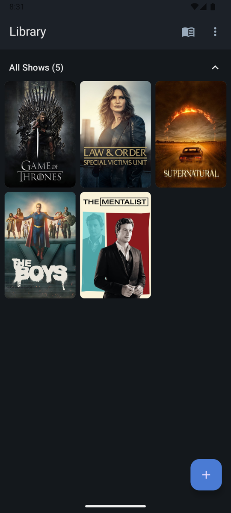
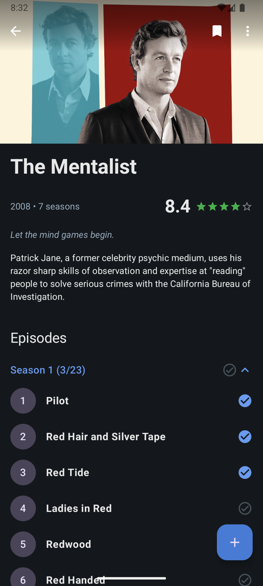
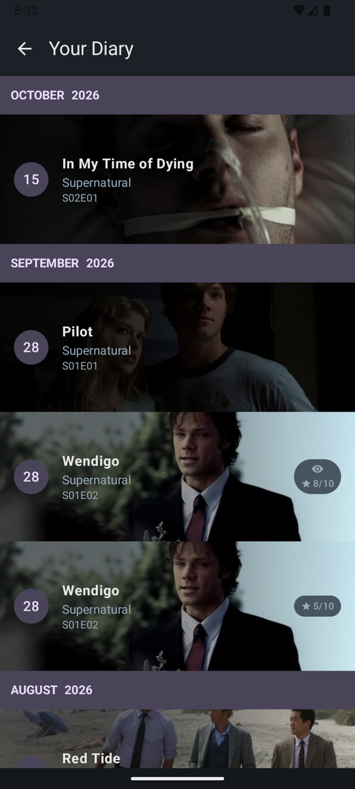

<div align="center">

# Binged

**Track every episode you watch, on every device**

[](https://developer.android.com)
[](https://kotlinlang.org)
[](https://developer.android.com/jetpack/compose)
[](https://www.themoviedb.org)
[](LICENSE)
[](https://github.com/mntramos/Binged/releases/latest)

</div>

**Binged** is a TV show tracker for Android. Search TMDB, track the shows you are watching, and log every episode with a date, notes and a rating — then read it all back as a chronological diary. Your library syncs across devices through Firebase, and the app runs on **your own TMDB API key**, so there is no shared quota and nothing to configure at build time.

---

## Features

### Tracking

| Feature | Description |
|:--------|:------------|
| **TMDB Search** | Search the full TMDB catalogue and track or untrack a show directly from the results, without leaving the search screen. |
| **Show Library** | Every tracked show in a grid or list layout, with **Watching** and **Favorites** sections kept separate from the rest of the library. |
| **Full Episode Catalogue** | The complete season and episode list for each show, fetched from TMDB — not just the episodes you have logged. |
| **Collapsible Seasons** | Seasons collapse and expand individually, and the state is remembered across restarts and devices. |
| **Seen State** | Mark any episode as seen independently of logging it. Season headers count seen episodes in their progress total. |
| **Watching & Favorites** | Flag a show as currently watching or a favorite from its detail screen; both persist and sync. |

### Logging

| Feature | Description |
|:--------|:------------|
| **Watch Log** | Log an episode with the date you watched it and any notes you want to keep. |
| **Rewatches** | The same episode can be logged as many times as you have watched it. Each watch is its own entry with its own date, notes and rating. |
| **Per-Entry Rating** | Score each watch from 1 to 10, independently of any other watch of that episode. Ratings are optional. |
| **TMDB Verification** | The show, season and episode you enter are checked against TMDB before the entry is saved, so typos cannot create phantom episodes. |
| **Watch History** | The episode detail screen lists every watch of that episode, newest first, with in-place editing and per-entry deletion. |

### Diary & Statistics

| Feature | Description |
|:--------|:------------|
| **Monthly Diary** | Everything you have watched in one reverse-chronological list, grouped by month. |
| **Rewatch & Rating Badges** | Diary cards show at a glance whether a watch was a rewatch and what you scored it. |
| **Statistics** | Total episodes watched, shows tracked, hours watched, plus this week and this month. |
| **Edit & Delete** | Fix a note, change a rating or remove a single watch — other watches of the same episode are left untouched. |

### Account & Data

| Feature | Description |
|:--------|:------------|
| **Firebase Auth** | Email and password registration, or Google sign-in. Email verification is enforced before the app unlocks. |
| **Realtime Sync** | Your library and diary sync across devices through Firestore in both directions, with offline tolerance. |
| **Export & Import** | Back up your shows and watch history to a JSON file and restore it on another device. |
| **Bring Your Own Key** | The TMDB API key is yours and lives on your device. Change it any time from Settings → TMDB. |
| **Account Deletion** | Delete your account and all of its data — local database, remote documents and the stored API key. |
| **First-Run Tutorial** | A short walkthrough the first time you open the app. |

---

## Screenshots

<table align="center">
  <tr>
    <th align="center">Show Library</th>
    <th align="center">Show Detail</th>
    <th align="center">Diary</th>
  </tr>
  <tr>
    <td align="center"></td>
    <td align="center"></td>
    <td align="center"></td>
  </tr>
</table>

## Prerequisites

> [!IMPORTANT]
> Binged looks up every show and episode through [TMDB](https://www.themoviedb.org), which needs an API key. No key is bundled with the app: **each install runs on the key of whoever installed it**, kept on that device only.

| Step | Requirement | Details |
|:----:|:------------|:--------|
| 1 | **Create a TMDB account** | Free at [themoviedb.org](https://www.themoviedb.org/signup). |
| 2 | **Request an API key** | Open [Settings → API](https://www.themoviedb.org/settings/api) on TMDB and request a key. Either the **API Read Access Token** or the 32-character **API Key** works — Binged accepts both. |
| 3 | **Paste it into Binged** | After signing in, the app asks for the key and verifies it against TMDB before saving. Get it wrong and it tells you straight away, without overwriting a key that already works. |

Building the app yourself needs more than this — see [From source](#from-source) for the Firebase project you will also have to create.

---

## Installation

### From a release

| Step | Action |
|:----:|:-------|
| 1 | Open the [Releases](../../releases) page. |
| 2 | Download the latest `Binged-release-X.X.X.apk`. |
| 3 | Install it on an Android 10 or newer device. |
| 4 | Sign in or create an account, then verify your email. |
| 5 | Paste your TMDB key when prompted. |
| 6 | Track a show and log your first episode. |

### From source

> [!IMPORTANT]
> Binged authenticates and syncs through Firebase, and that configuration is **not** in the repository. You need your own Firebase project before the app will build. Your data then lives in your project, not anyone else's.

| Step | Action |
|:----:|:-------|
| 1 | Create a project in the [Firebase console](https://console.firebase.google.com). |
| 2 | Add an Android app with the package name `com.app.binged`. |
| 3 | Enable **Authentication → Email/Password**, plus **Google** if you want that provider. Register your debug keystore's SHA-1 for Google sign-in. |
| 4 | Create a **Cloud Firestore** database — the library and diary sync there. |
| 5 | Download `google-services.json` and save it as `app/google-services.json`. The build fails without it. |
| 6 | For Google sign-in, add `GOOGLE_WEB_CLIENT_ID=<your web client id>` to `local.properties`. |

Once that is in place:

```bash
git clone https://github.com/mntramos/Binged.git
cd Binged
./gradlew assembleDebug
```

The debug build lands in `app/build/outputs/apk/debug/`. A JDK 17 or newer is required; the project is developed against JDK 21.

`local.properties` holds your SDK path and is created automatically when you open the project in Android Studio.

No TMDB credentials are needed to build — the key is entered in the app at runtime.

---

## Built With

| Technology | Purpose |
|:-----------|:--------|
| **[Kotlin](https://kotlinlang.org/)** | 100% native Android development. |
| **[Jetpack Compose](https://developer.android.com/jetpack/compose)** | Declarative UI with Material 3 and a dark-first theme. |
| **[Hilt](https://dagger.dev/hilt/)** | Dependency injection across every module. |
| **[Navigation Compose](https://developer.android.com/guide/navigation)** | Navigation graph: auth, then the API key gate, then the main app. |
| **[Room](https://developer.android.com/training/data-storage/room)** | Local database with explicit migrations for every schema change. |
| **[Retrofit](https://square.github.io/retrofit/) + [OkHttp](https://square.github.io/okhttp/)** | TMDB networking, with the user's credential injected per request. |
| **[Firebase Auth](https://firebase.google.com/docs/auth)** | Email/password and Google sign-in. |
| **[Cloud Firestore](https://firebase.google.com/docs/firestore)** | Realtime two-way sync of your library and diary. |
| **[Crashlytics](https://firebase.google.com/docs/crashlytics)** | Crash reporting. |
| **[Coil](https://coil-kt.github.io/coil/)** | Poster and still image loading. |
| **[TMDB API](https://developer.themoviedb.org/docs)** | Show, season and episode metadata. |

---

## Disclaimer

> [!NOTE]
> This product uses the TMDB API but is not endorsed or certified by TMDB.

Binged is an unofficial, independent project. It is not affiliated with, endorsed by or sponsored by TMDB or any streaming service. Show metadata and artwork belong to their respective owners.

Your TMDB API key is stored on your device only and is never uploaded or shared; it is used solely to make requests from the app. Deleting your account removes it.

---

## License

Released under the MIT License — see [LICENSE](LICENSE) for details.

---

<div align="center">

If Binged is useful to you, **star this repo** — it helps the project grow.

</div>
